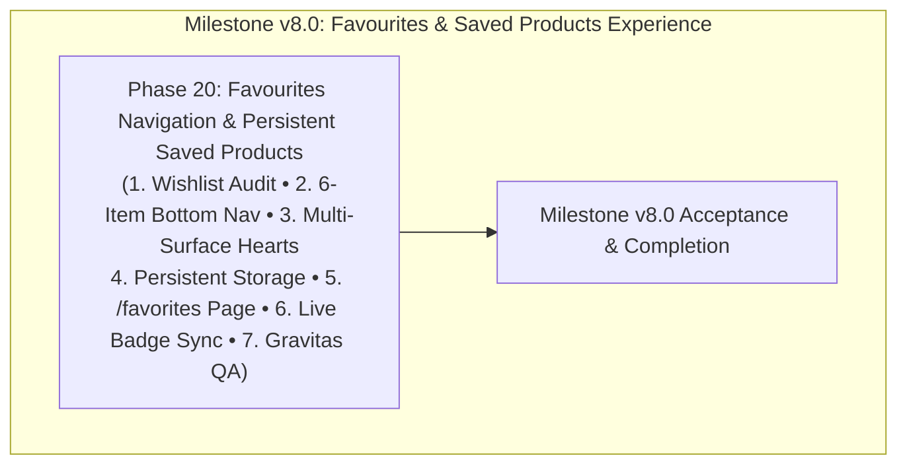

# ROADMAP.md — Milestone v8.0: Favourites & Saved Products Experience

**Milestone:** v8.0 — Favourites & Saved Products Experience  
**Core Goal:** Implement a complete, end-to-end Favourites feature across The Irish Grocer website—including a 6-item mobile bottom navigation with live badge, persistent saved-products storage, multi-surface product heart interactions, a dedicated `/favorites` page with sorting and empty state, and full regression verification.  
**Commerce Mode:** `NEXT_PUBLIC_COMMERCE_MODE=demo`  
**Frameworks:** GSD Primary + CodeRabbit Review + Gravitas Visual QA  
**Execution Structure:** Exactly one single implementation phase: **Phase 20**.

---

## Milestone v8.0 Phase Overview

---

## Phase Details

### Phase 20: Favourites Navigation & Persistent Saved Products
- **Status:** Completed & Verified (All 4 Waves Executed, 146/146 Tests Passing, 20/20 Gravitas Browser Scenarios Verified)
- **Primary Goal:** Implement the complete Favourites experience across mobile, tablet, and desktop:
  1. **Existing Wishlist Architecture Audit:** Audit and harden `useWishlist.ts` with deduplication, malformed data safety, clear action, and count tracking.
  2. **6-Item Bottom Navigation:** Update `MobileBottomNav.tsx` to 6 equal-width items (Home, Shop, Search, Favourites, Cart, Account) fitting cleanly at 360px, 390px, 430px with $\ge 44\times 44\text{px}$ touch targets and live badge.
  3. **Multi-Surface Heart Interactions:** Ensure all product surfaces (`ProductCard`, `ProductListCard`, `QuickViewModal`, and `ProductDetailsClient`) share the exact same reactive wishlist state and toggle behavior.
  4. **Persistent Storage:** Preserve saved products reliably in `localStorage` under `irish_grocer_wishlist` across page refresh, navigation, and cross-tab storage events.
  5. **Dedicated Favourites Page:** Create `/favorites` with Playfair Display heading, product count, sort controls, 2-column mobile / multi-column desktop grid, and polished empty state (`No favourites yet` with `Discover Products` link).
  6. **Live Badge Synchronization:** Ensure the bottom navigation heart badge (and page counts) update immediately on save, remove, clear, or cross-tab events.
  7. **Quality Gates & Gravitas Verification:** 100% test pass rate on automated suite, 0 TypeScript errors, 0 ESLint warnings, 0 build errors, 0 console errors, 0 horizontal overflow across 10 viewports, and $\ge 95\%$ baseline visual similarity.
- **Files Modified/Created:**
  - `website/src/components/layout/MobileBottomNav.tsx`
  - `website/src/hooks/useWishlist.ts`
  - `website/src/components/products/ProductListCard.tsx`
  - `website/src/components/products/QuickViewModal.tsx`
  - `website/src/app/products/[handle]/ProductDetailsClient.tsx`
  - `website/src/app/favorites/page.tsx` *(new)*
  - `website/src/app/favorites/FavoritesClientView.tsx` *(new)*
  - `website/tests/phase20-favorites.test.ts` *(new)*
  - `website/package.json`
- **Stop Condition:** Stop after Phase 20. Do not start Phase 21 or another milestone.
