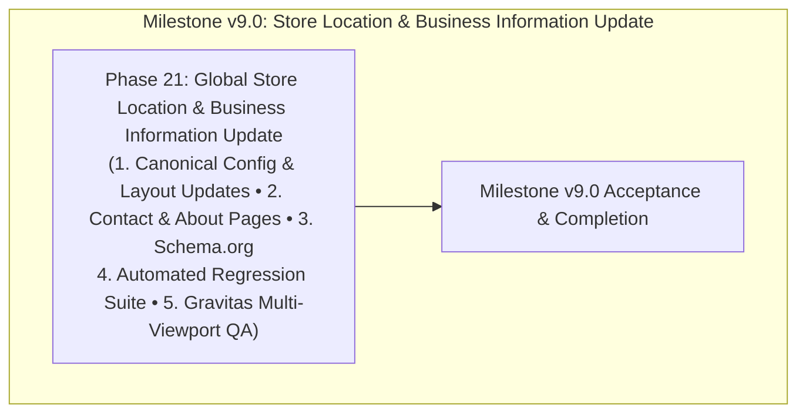

# ROADMAP.md — Milestone v9.0: Store Location & Business Information Update

**Milestone:** v9.0 — Store Location & Business Information Update  
**Core Goal:** Update physical store location, telephone, email, operating hours, delivery messaging, brand positioning, and structured SEO business data throughout the entire Irish Grocer website across desktop, tablet, and mobile.  
**Commerce Mode:** `NEXT_PUBLIC_COMMERCE_MODE=demo`  
**Frameworks:** GSD Primary + CodeRabbit Review + Gravitas Visual QA  
**Execution Structure:** Exactly one single implementation phase: **Phase 21**.

---

## Milestone v9.0 Phase Overview

---

## Phase Details

### Phase 21: Global Business Location & Contact Information Standardization
- **Status:** Completed & Fully Verified
- **Primary Goal:** Update all store location and business contact touchpoints:
  1. **Canonical Config:** Update `src/lib/config/site.ts` with `Marshfield Store`, `1899 Ocean St, Marshfield, Massachusetts` (no 02050 ZIP code), phone `7746990889` / `(774) 699-0889`, email `irishgrocer@gmail.com`, hours `Open Daily · 9 AM – 9 PM`, delivery `We Deliver!`, brand messaging `Fresh Food · Irish Favorites · Everyday Needs`.
  2. **Header & Navigation:** Mobile header location pill displays exactly `Marshfield, MA`, desktop store link displays `Marshfield Store` with title `Marshfield, Massachusetts Store: (774) 699-0889`, and mobile drawer displays `Visit Our Marshfield Store`.
  3. **Homepage Sections:** Update `MobileStoreConfidenceStrip.tsx` (`Marshfield Store`, `1899 Ocean St, Marshfield, Massachusetts`, `Open Daily · 9 AM – 9 PM`), `StoreInfoSection.tsx`, `HeroSection.tsx`, and `MobilePromoBanner.tsx`.
  4. **Site-wide Touchpoints:** Update `Footer.tsx`, `OrderEnquiryModal.tsx`, `cart/page.tsx`, `CartDrawer.tsx`, `ShopClientView.tsx`, `shop/page.tsx`, `SearchClientView.tsx`, `ProductDetailsClient.tsx`, `privacy/page.tsx`.
  5. **Dedicated Pages & Schema:** Add `src/app/contact/page.tsx`, `src/app/about/page.tsx`, and `LocalBusiness` / `GroceryStore` Schema.org JSON-LD in `layout.tsx`.
  6. **Automated Quality Gates:** Create `tests/phase21-business-info-update.test.ts`, ensure 100% pass across all 10 test suites, 0 tsc errors, 0 lint warnings, 0 build errors.
  7. **Gravitas Multi-Viewport Browser Verification:** Validate 10 viewports (360px–1920px) and 9 routes (`/`, `/shop`, `/search`, `/favorites`, `/account`, `/contact`, `/about`, `/cart`, `/collections/crisps-snacks`), confirming 0 console errors, 0 overflow, and valid clickable links.
- **Files Modified/Created:**
  - `website/src/lib/config/site.ts`
  - `website/.env.local` & `website/.env.example`
  - `website/src/components/layout/Header.tsx`
  - `website/src/components/layout/MobileDrawer.tsx`
  - `website/src/components/home/mobile/MobileStoreConfidenceStrip.tsx`
  - `website/src/components/home/mobile/MobilePromoBanner.tsx`
  - `website/src/components/home/StoreInfoSection.tsx`
  - `website/src/components/home/HeroSection.tsx`
  - `website/src/components/enquiry/OrderEnquiryModal.tsx`
  - `website/src/app/cart/page.tsx` & `website/src/components/cart/CartDrawer.tsx`
  - `website/src/app/shop/ShopClientView.tsx` & `website/src/app/shop/page.tsx`
  - `website/src/app/search/SearchClientView.tsx`
  - `website/src/app/products/[handle]/ProductDetailsClient.tsx`
  - `website/src/app/privacy/page.tsx`
  - `website/src/app/contact/page.tsx` *(new)*
  - `website/src/app/about/page.tsx` *(new)*
  - `website/src/app/layout.tsx`
  - `website/tests/phase21-business-info-update.test.ts` *(new)*
  - `website/package.json`
- **Stop Condition:** Stop after Phase 21. Do not start another milestone or phase.
