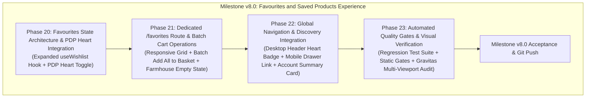

# ROADMAP.md — Milestone v8.0: Favourites and Saved Products Experience

**Milestone:** v8.0 — Favourites and Saved Products Experience  
**Core Goal:** Deliver an authentic, delightful, and friction-free Irish grocery shopping experience where customers can effortlessly discover, save, and batch-purchase their favorite imported pantry staples across mobile, tablet, and desktop.  
**Commerce Mode:** `NEXT_PUBLIC_COMMERCE_MODE=demo`  
**Frameworks:** GSD (Orchestration) + Gravitas (Visual & Runtime QA)  
**Execution Structure:** Exactly 4 sequential phases (Phase 20 through Phase 23).  

---

## Milestone v8.0 Phase Overview

---

## Phase Details

### Phase 20: Favourites State Architecture & PDP Heart Integration
- **Status:** Ready to Plan (`/gsd-plan-phase 20`)
- **Primary Goal:** Expand the client-side wishlist state engine with reactive count tracking, clear actions, and batch helpers while preserving localStorage backward compatibility; integrate a touch-accessible styled heart toggle button on the Product Details Page (PDP).
- **Files Modified:**
  - `website/src/hooks/useWishlist.ts`
  - `website/src/app/products/[handle]/ProductDetailsClient.tsx`
- **Requirements Covered:**
  - **REQ-FAV-01**: Enhanced `useWishlist` hook (`wishlist`, `wishlistCount`, `isWishlisted`, `toggleWishlist`, `clearWishlist`, cross-tab sync).
  - **REQ-FAV-02**: PDP heart toggle button alongside quantity selector and Add to Basket actions with active heart styling and accessible ARIA attributes.
- **Verification Criteria:**
  - Unit test verifying all `useWishlist` methods and storage events.
  - PDP renders touch-accessible heart button ($\ge 44\times 44\text{px}$) that toggles active state and updates localStorage.

---

### Phase 21: Dedicated `/favorites` Destination & Batch Operations
- **Status:** Pending Phase 20 Completion
- **Primary Goal:** Author a dedicated, beautifully branded `/favorites` destination page displaying saved products in the standard 2-column mobile and multi-column desktop grid, featuring batch "Add All to Basket" CTA, individual item removal, and a warm farmhouse empty state with shortcut links to popular Irish aisles.
- **Files Created/Modified:**
  - `website/src/app/favorites/page.tsx`
  - `website/src/app/favorites/FavoritesClientView.tsx`
- **Requirements Covered:**
  - **REQ-FAV-03**: Dedicated `/favorites` route with responsive product grid.
  - **REQ-FAV-04**: "Add All Available to Basket" batch action that adds in-stock wishlisted items and opens CartDrawer.
  - **REQ-FAV-05**: B2B wholesale pricing gate: unauthenticated visitors are prompted to log in before batch-adding to cart.
  - **REQ-FAV-06**: Warm farmhouse empty state card in Warm Cream (`#FFFAF1`) with Playfair Display heading and quick-link pills to popular aisles.
  - **REQ-FAV-07**: Individual remove button and "Clear All Saved" confirmation action.
- **Verification Criteria:**
  - `/favorites` renders saved products with accurate item counts.
  - Clicking "Add All to Basket" populates the cart with all in-stock saved items and opens CartDrawer.
  - Empty state displays when 0 items are saved with functional aisle shortcut links.

---

### Phase 22: Global Navigation & Discovery Integration
- **Status:** Pending Phase 21 Completion
- **Primary Goal:** Connect the favourites experience across all major navigation entry points on desktop and mobile.
- **Files Modified:**
  - `website/src/components/layout/Header.tsx`
  - `website/src/components/layout/MobileDrawer.tsx`
  - `website/src/app/account/page.tsx`
- **Requirements Covered:**
  - **REQ-FAV-08**: Desktop floating header Heart icon button with live dynamic counter badge in utility row.
  - **REQ-FAV-09**: Mobile navigation drawer "Saved Items" link with heart icon and live counter badge.
  - **REQ-FAV-10**: Customer account page (`/account`) "Saved Farmhouse Provisions" summary card linking to `/favorites`.
- **Verification Criteria:**
  - Desktop header shows heart button with live badge that updates reactively across pages and tabs.
  - Mobile drawer displays "Saved Items" with accurate live count.
  - Account page card shows current saved count and navigates cleanly to `/favorites`.

---

### Phase 23: Automated Quality Gates & Visual Verification
- **Status:** Pending Phase 22 Completion
- **Primary Goal:** Author dedicated automated test suite, verify all static toolchain gates, and conduct comprehensive Gravitas browser testing across 10 viewports ensuring zero console errors, zero uncaught exceptions, zero horizontal overflow, and strict design preservation.
- **Files Created/Modified:**
  - `website/tests/phase20-favorites.test.ts`
  - `website/package.json`
- **Requirements Covered:**
  - **REQ-FAV-11**: Dedicated automated regression test suite covering all favorites operations and navigation.
  - **REQ-FAV-12**: Static toolchain verification passes 100% clean (`npm test`, `npx tsc --noEmit`, `npm run lint`, `npm run build`).
  - **REQ-FAV-13**: Gravitas multi-viewport visual regression audit across 10 viewports (360px to 1920px) confirming $\ge 95\%$ visual similarity and zero unexpected layout shift.
- **Verification Criteria:**
  - All test suites passing (100% clean).
  - TypeScript, ESLint, and Next.js build compile with 0 errors.
  - Browser CDP audit verifies 0 console errors and 0 horizontal overflow.
