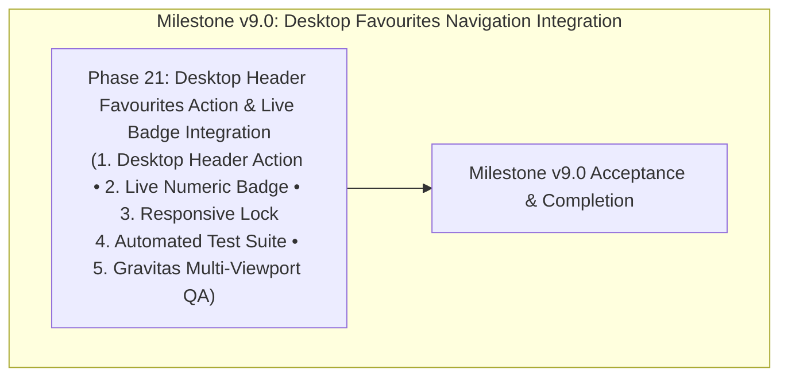

# ROADMAP.md — Milestone v9.0: Desktop Favourites Navigation Integration

**Milestone:** v9.0 — Desktop Favourites Navigation Integration  
**Core Goal:** Integrate a polished, accessible Favourites navigation action into the desktop header (`Header.tsx`) on screens $\ge 1024\text{px}$, complete with live numeric badge count, active route highlight, mobile exclusion, and comprehensive Gravitas regression verification.  
**Commerce Mode:** `NEXT_PUBLIC_COMMERCE_MODE=demo`  
**Frameworks:** GSD Primary + CodeRabbit Review + Gravitas Visual QA  
**Execution Structure:** Exactly one single implementation phase: **Phase 21**.

---

## Milestone v9.0 Phase Overview

---

## Phase Details

### Phase 21: Desktop Header Favourites Action & Live Badge Integration
- **Status:** Scoped & Ready for Planning (Planning Gate — Zero Application Code Edits)
- **Primary Goal:** Integrate Favourites into the desktop navigation header:
  1. **Desktop Header Action:** Add a dedicated Favourites action to `website/src/components/layout/Header.tsx` on $\ge 1024\text{px}$ viewports alongside Store, Account, and Cart.
  2. **Icon & Label:** Use `Heart` icon from `lucide-react` (filled `#14532D` when active, outline when idle) with `Favourites` label and minimum $44\times 44\text{px}$ touch target.
  3. **Live Numeric Badge:** Render a dynamic count badge (`#22C55E` background, `#14532D` text) when `wishlist.length > 0`, synchronized with `useWishlist`.
  4. **Responsive Boundaries:** Strictly hide on `< 1024px` viewports (where `MobileBottomNav` operates). Preserve desktop layout geometry with 0 horizontal overflow.
  5. **Automated Quality Gates:** Create `tests/phase21-desktop-favorites.test.ts`, update `package.json`, verify 100% pass across all 9 suites, 0 tsc errors, 0 lint warnings, 0 build errors.
  6. **Gravitas Multi-Viewport Browser Verification:** Validate 10 viewports (360px–1920px), 0 console errors, 0 uncaught exceptions, 0 overflow, and $\ge 95\%$ desktop visual similarity.
- **Files Modified/Created:**
  - `website/src/components/layout/Header.tsx`
  - `website/tests/phase21-desktop-favorites.test.ts` *(new)*
  - `website/package.json`
- **Stop Condition:** Stop after Phase 21. Do not start Phase 22 or another milestone.
