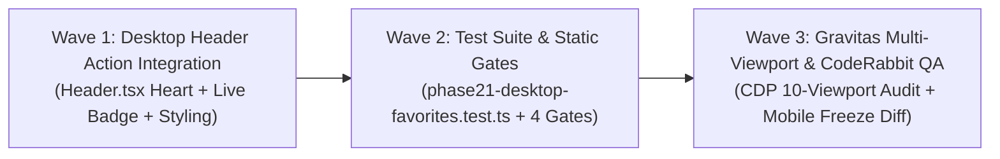

# Phase 21: Desktop Header Favourites Integration
## Master Execution Plan

**Milestone:** v9.0 — Desktop Favourites Navigation Integration  
**Phase:** Phase 21 (Single Implementation Phase)  
**Frameworks:** GSD Primary + CodeRabbit Review + Gravitas Visual QA  
**Commerce Mode:** `NEXT_PUBLIC_COMMERCE_MODE=demo`  
**Status:** Planning Gate (Awaiting User Review & Approval)  

---

## 1. Phase Objective

Integrate a dedicated, accessible, and responsive Favourites heart navigation control into the existing desktop header (`website/src/components/layout/Header.tsx`) on screens $\ge 1024\text{px}$, positioned between Account and Cart in the first-row desktop action controls.

**Strict Mobile Design Freeze Constraint:**
The entire mobile interface ($< 1024\text{px}$) remains 100% frozen. No modifications to `MobileBottomNav.tsx`, no desktop heart injected into the mobile header, no changes to mobile layouts, product cards, or search toolbars.

---

## 2. Desktop First-Row Navigation Arrangement

The first row of the desktop navigation ($\ge 1024\text{px}$) will strictly follow this exact order:

```
[1. Irish Grocer Logo]  ----  [2. Global Search Capsule]  ----  [3. Quincy Store]  [4. Sign in / Account]  [5. Favourites (Heart + Badge)]  [6. Cart]
```

Second-row department and category navigation (`CATEGORY_NAVIGATION_LINKS`) remains completely unchanged.

---

## 3. Wave Decompositions



### Wave 1: Desktop Header Favourites Action & Live Badge Integration (`21-01-PLAN.md`)
- **Target File:** `website/src/components/layout/Header.tsx`
- **Component Imports:** Import `Heart` from `lucide-react` and `useWishlist` from `@/hooks/useWishlist`.
- **State Hooks:** Consume `const { wishlistCount, isLoaded } = useWishlist();`.
- **Active Route Detection:** Derive `const isFavoritesActive = pathname === "/favorites";`.
- **Element Placement:** Insert between the Customer Account Link and the Shopping Cart Button inside the desktop action controls container (`hidden lg:grid ... lg:grid-cols-[200px_minmax(340px,580px)_auto]`).
- **Styling & States:**
  - Container classes: `hidden lg:inline-flex items-center gap-1.5 text-xs xl:text-[13px] font-semibold text-[#14532D] hover:text-[#064E3B] hover:bg-[#14532D]/6 px-2.5 py-1.5 rounded-xl transition-all focus:outline-none focus-visible:ring-2 focus-visible:ring-[#14532D]`
  - Active state: `isFavoritesActive ? "bg-[#14532D]/10 font-bold" : ""`
  - Icon: `Heart` icon with `w-4 h-4` (outline when idle/empty, filled `#14532D` when active or on `/favorites`).
  - Badge: `absolute -top-1.5 -right-2 bg-[#22C55E] text-[#14532D] text-[10px] font-extrabold w-4 h-4 rounded-full flex items-center justify-center shadow-xs border border-white`, rendered when `isLoaded && wishlistCount > 0`.
  - Label: `<span className="hidden xl:inline">Favourites</span>` matching `Quincy Store`'s `hidden xl:inline`.
  - Semantic link: `<Link href="/favorites" ... aria-current={isFavoritesActive ? "page" : undefined} aria-label={\`Favourites, ${wishlistCount} saved products\`}>`.
- **Safety Invariant:** All changes isolated inside the `hidden lg:grid` desktop region. Zero edits to `lg:hidden` mobile header block.

### Wave 2: Automated Regression Suite & Static Quality Gates (`21-02-PLAN.md`)
- **Target Files:** `website/tests/phase21-desktop-favorites.test.ts`, `website/package.json`
- **Automated Tests:**
  1. Desktop header contains Favourites link between Account and Cart.
  2. Desktop Favourites link navigates directly to `/favorites`.
  3. Desktop Favourites link renders `Heart` icon with active filled state on `/favorites`.
  4. Desktop Favourites link renders live count badge matching Cart badge styling.
  5. Desktop Favourites link has accessible `aria-label` with item count.
  6. Desktop Favourites link is hidden below 1024px (`hidden lg:inline-flex`).
  7. Mobile header has 0 desktop heart controls (strict mobile freeze).
  8. `MobileBottomNav.tsx` remains completely untouched (strict mobile freeze).
  9. `ProductCard.tsx` design invariants remain protected.
  10. Favouriting products updates both desktop header and mobile bottom nav simultaneously.
- **Static Quality Gates:**
  1. `npm test` $\rightarrow$ 100% pass across all 9 suites.
  2. `npx tsc --noEmit` $\rightarrow$ 0 TypeScript compiler errors.
  3. `npm run lint` $\rightarrow$ 0 ESLint warnings, 0 errors.
  4. `npm run build` $\rightarrow$ compile all 33 routes including `/favorites`.

### Wave 3: Gravitas Multi-Viewport CDP Browser Audit & CodeRabbit Review (`21-03-PLAN.md`)
- **Target:** Live CDP testing script `scratch/phase21_verification.cjs`
- **Desktop Viewport Verification (1024px, 1280px, 1440px, 1920px):**
  - Heart appears between Account and Cart in desktop header.
  - Badge count reflects existing wishlist in real time.
  - Saving a product updates the desktop badge immediately.
  - Removing a product updates the badge immediately.
  - Clearing all favourites hides the zero-count badge.
  - Clicking the heart navigates directly to `/favorites`.
  - Active heart appearance is correct on `/favorites`.
  - Header remains floating sticky at `top: 16px`.
  - 0 horizontal overflow (`scrollWidth <= innerWidth`).
- **Mobile Design Freeze Verification (360px, 390px, 430px):**
  - All 6 mobile bottom nav destinations remain in exact order (`Home`, `Shop`, `Search`, `Favourites`, `Cart`, `Account`).
  - No additional mobile header heart appears.
  - No mobile layout or typography changes.
  - 0 horizontal overflow.
- **Runtime Health:** 0 console errors, 0 uncaught exceptions.
- **Visual Baseline Preservation:** Desktop baseline comparison ($\ge 95\%$ visual similarity against approved v8.0 baselines).
- **CodeRabbit Review:** Static review of modified files.

---

## 4. Verification & Acceptance Criteria

- [ ] Desktop first-row header contains: Logo $\rightarrow$ Search $\rightarrow$ Quincy Store $\rightarrow$ Sign in/Account $\rightarrow$ Favourites $\rightarrow$ Cart.
- [ ] Favourites heart link points to `/favorites` without opening a drawer or modal.
- [ ] Active filled heart and background highlight on `/favorites`.
- [ ] Live numeric badge reflects `wishlistCount` and hides when count is 0.
- [ ] Complete mobile design freeze: `MobileBottomNav.tsx` untouched; mobile header untouched.
- [ ] 100% test pass rate across all 9 automated test suites.
- [ ] 0 TypeScript compiler errors, 0 ESLint warnings, 0 build errors.
- [ ] 0 horizontal overflow across all 10 viewports (360px–1920px).
- [ ] 0 console errors, 0 uncaught exceptions in live browser testing.
