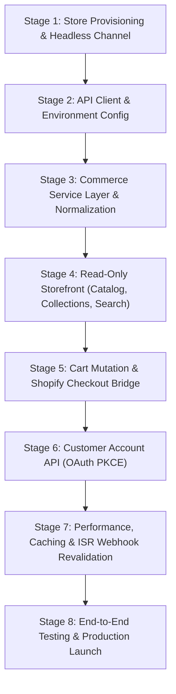

# THE IRISH GROCER — SHOPIFY INTEGRATION IMPLEMENTATION ROADMAP

**Project:** The Irish Grocer  
**Scope:** 8-Stage Execution Plan for Live Shopify Backend Activation  
**Safety Protocol:** Non-destructive execution; local mock fallback remains accessible at every stage via `NEXT_PUBLIC_COMMERCE_MODE=demo`.

---

## Roadmap Overview



---

## Stage 1: Store Provisioning & Headless Channel Configuration

### Objective:
Establish the Shopify backend store, install the official Headless sales channel, and configure Storefront API scopes.

- **Dependencies & Prerequisites:** Shopify Account with Admin privileges for `the-irish-grocer.myshopify.com`.
- **Affected Files:** None (Shopify Admin configuration only).
- **Execution Steps:**
  1. Log in to Shopify Admin.
  2. Navigate to **Sales Channels** > **Add Sales Channel** > install **Headless**.
  3. Create a new Storefront named "The Irish Grocer Web".
  4. Generate Storefront API Public Access Token with permissions for:
     - Products, Collections, Inventory, Tags
     - Unauthenticated Checkouts & Carts
     - Customer Accounts & Content
  5. Note the generated token and store domain (`the-irish-grocer.myshopify.com`).
- **Acceptance Criteria:**
  - Storefront API Public Token generated.
  - GraphQL Explorer test query against the store returns HTTP 200 with `{ shop { name } }`.
- **Rollback Strategy:**
  - Revoke token or delete headless sales channel if compromised. Frontend remains on demo mode.

---

## Stage 2: Storefront API Client & Environment Configuration

### Objective:
Safely inject live Shopify credentials into local and hosting environments without committing secrets to Git.

- **Dependencies & Prerequisites:** Completion of Stage 1 tokens.
- **Affected Files:**
  - `website/.env.local` (Local secret file, Git-ignored)
  - Vercel Project Settings > Environment Variables
- **Execution Steps:**
  1. In `website/.env.local`, set:
     ```env
     NEXT_PUBLIC_COMMERCE_MODE=production
     SHOPIFY_STORE_DOMAIN=the-irish-grocer.myshopify.com
     SHOPIFY_STOREFRONT_ACCESS_TOKEN=<your_actual_public_token>
     SHOPIFY_STOREFRONT_API_VERSION=2026-10
     ```
  2. Verify `.gitignore` continues to ignore `.env.local`.
  3. Mirror variables in Vercel Production & Preview environments.
- **Acceptance Criteria:**
  - Running `git status` verifies `.env.local` is untracked and clean.
  - Next.js server boots and correctly reads environment variables in Route Handlers.
- **Rollback Strategy:**
  - Set `NEXT_PUBLIC_COMMERCE_MODE=demo` to revert immediately to local mock data.

---

## Stage 3: Commerce Service Layer & Data Normalization

### Objective:
Finalize the normalization functions in `src/lib/shopify/index.ts` to seamlessly convert Storefront API 2026-10 responses into the existing `Product`, `Collection`, and `Cart` TypeScript types.

- **Dependencies & Prerequisites:** Stage 2 environment variables active.
- **Affected Files:**
  - `src/lib/shopify/index.ts`
  - `src/lib/shopify/queries.ts`
  - `src/types/index.ts`
- **Execution Steps:**
  1. Confirm `shopifyFetch` uses the configured `SHOPIFY_STOREFRONT_API_VERSION=2026-10`.
  2. Verify GraphQL query fragments request all necessary fields (`featuredImage`, `priceRange`, `tags`, `variants`).
  3. Ensure the normalization helper falls back gracefully if an optional field (e.g., `barcode` or `compareAtPrice`) is null.
  4. Verify that case-insensitive tag matching preserves the "Bestseller" and "New" badge UI.
- **Acceptance Criteria:**
  - `getProducts()` returns strongly typed `Product[]` array directly from Shopify.
  - `getProductByHandle(handle)` returns valid product with images and variants.
- **Rollback Strategy:**
  - If GraphQL fails, `shopifyFetch` automatically catches the exception and returns the 34 local mock products.

---

## Stage 4: Read-Only Storefront Integration (Catalog, Collections, Search)

### Objective:
Switch catalog browsing, department filtering, and search to live Shopify data while preserving all visual designs.

- **Dependencies & Prerequisites:** Stage 3 normalization verified.
- **Affected Files:**
  - `src/app/shop/page.tsx`
  - `src/app/products/[handle]/page.tsx`
  - `src/app/collections/[handle]/page.tsx`
  - `src/app/search/page.tsx`
  - `src/components/product/ProductCard.tsx`
- **Execution Steps:**
  1. Audit `/shop` catalog to ensure all live products display inside the standardized `#DDF1D5` pale mint cards.
  2. Test dynamic product pages (`/products/[handle]`) for live inventory and pricing.
  3. Validate `/collections/[handle]` across all 16 departments.
  4. Test predictive search bar with live keywords (e.g., "Barry's", "Tayto", "Sausages").
- **Acceptance Criteria:**
  - Visual layout is 100% identical to current design.
  - Pale mint card background (`#DDF1D5`), shamrock badges, and wishlist icons render correctly.
  - Zero hydration errors or broken image tags.
- **Rollback Strategy:**
  - Toggle `NEXT_PUBLIC_COMMERCE_MODE=demo` to instantly revert to mock products.

---

## Stage 5: Cart Mutation & Shopify Checkout Bridge

### Objective:
Connect the existing slideout cart drawer and floating bottom bar to live Shopify Cart mutations and implement seamless checkout redirection.

- **Dependencies & Prerequisites:** Stage 4 live catalog active.
- **Affected Files:**
  - `src/context/CartContext.tsx`
  - `src/app/api/cart/route.ts`
  - `src/lib/shopify/mutations.ts`
  - `src/components/cart/CartDrawer.tsx`
- **Execution Steps:**
  1. In `src/app/api/cart/route.ts`, handle:
     - `POST` with no `cartId`: calls `cartCreate`.
     - `POST` with `cartId` & `lines`: calls `cartLinesAdd`.
     - `PUT` with `cartId` & `lines`: calls `cartLinesUpdate`.
     - `DELETE` with `cartId` & `lineIds`: calls `cartLinesRemove`.
  2. Store the returned Shopify `cartId` in a secure client cookie (`irish_cart_id`).
  3. Bind the "Proceed to Checkout" button to redirect directly to `cart.checkoutUrl`.
  4. Retain the "Call Direct to Reserve" CTA for perishable items (e.g., Butcher's Fancy sausages).
- **Acceptance Criteria:**
  - Adding an item creates a real Shopify cart.
  - Cart drawer reflects real-time totals and line item quantities.
  - Clicking "Proceed to Checkout" opens the official Shopify Hosted Checkout page with all items pre-loaded.
- **Rollback Strategy:**
  - Fall back to local storage simulated cart if `/api/cart` returns an error status.

---

## Stage 6: Customer Account API (OAuth 2.0 PKCE)

### Objective:
Implement passwordless customer authentication using the official Shopify Customer Account API.

- **Dependencies & Prerequisites:** Customer Account API enabled in Shopify Admin.
- **Affected Files:**
  - `src/app/api/auth/[...shopify]/route.ts`
  - `src/app/account/login/page.tsx`
  - `src/app/account/page.tsx`
- **Execution Steps:**
  1. Configure Headless customer account login in Shopify Admin:
     - Set Allowed Callback URL: `https://theirishgrocer.com/api/auth/callback`.
     - Set Allowed Logout URL: `https://theirishgrocer.com/`.
  2. Implement OAuth PKCE route handlers:
     - Generate code verifier and challenge.
     - Store verifier in HTTP-only cookie.
     - Exchange code for customer access token upon callback.
  3. Populate `/account` dashboard with real customer order history and saved delivery addresses.
- **Acceptance Criteria:**
  - Customer can sign in without passwords using Shopify OTP / Passkeys.
  - Account dashboard displays order history and delivery address.
- **Rollback Strategy:**
  - Keep mock demo account accessible if OAuth client ID is not configured.

---

## Stage 7: Performance, Caching & ISR Webhook Revalidation

### Objective:
Implement automated on-demand cache revalidation via Shopify Webhooks so catalog changes reflect instantly without site redeploys.

- **Dependencies & Prerequisites:** Production domain assigned (`theirishgrocer.com`).
- **Affected Files:**
  - `src/app/api/shopify/revalidate/route.ts`
  - `src/lib/shopify/index.ts`
- **Execution Steps:**
  1. Create `/api/shopify/revalidate/route.ts` with HMAC SHA-256 signature verification.
  2. Configure webhooks in Shopify Admin pointing to `https://theirishgrocer.com/api/shopify/revalidate`:
     - `products/update`
     - `products/delete`
     - `inventory_levels/update`
     - `collections/update`
  3. Upon verified webhook event, invoke `revalidateTag('products')` and `revalidateTag('collections')`.
- **Acceptance Criteria:**
  - Editing a product price in Shopify Admin updates the live storefront within 2 seconds.
  - Invalid HMAC signatures receive HTTP 401 Unauthorized.
- **Rollback Strategy:**
  - Static fallback with time-based ISR (`revalidate: 3600`) ensures pages remain fresh even if webhooks fail.

---

## Stage 8: End-to-End Testing, Security Audit & Production Launch

### Objective:
Conduct end-to-end commerce verification, test transactions with Shopify Bogus Gateway, execute security scans, and launch.

- **Dependencies & Prerequisites:** All stages 1–7 complete.
- **Affected Files:** Complete repository.
- **Execution Steps:**
  1. Set Shopify Payments to Test Mode (Bogus Gateway).
  2. Execute end-to-end user journey:
     - Browse catalog on mobile (390px) and desktop (1440px).
     - Add multiple items (tea, crisps, biscuits) to cart.
     - Proceed to Shopify checkout.
     - Complete test purchase using card `1` (successful transaction).
     - Verify order confirmation email is dispatched.
     - Verify order appears in customer account dashboard.
  3. Conduct security header check (CSP, CORS, frame-ancestors).
  4. Perform Lighthouse / Core Web Vitals audit (verify Performance >= 95, LCP < 1.8s).
  5. Switch Shopify Payments from Test Mode to Live Mode.
- **Acceptance Criteria:**
  - 100% successful test checkout transaction.
  - Zero console errors or layout shifts.
  - Live customer ordering fully functional.
- **Rollback Strategy:**
  - Instant zero-downtime rollback in Vercel to previous deployment if any critical issue arises.

