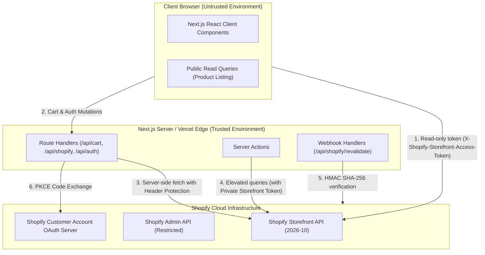
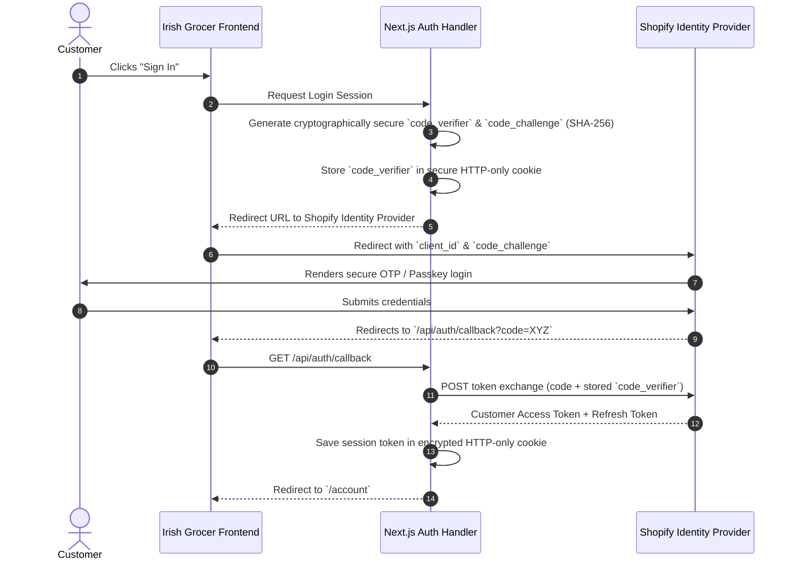

# THE IRISH GROCER — SHOPIFY HEADLESS SECURITY ARCHITECTURE

**Project:** The Irish Grocer  
**Scope:** Storefront API Security, Credential Management, Customer Authentication (PKCE), Webhook Integrity & Threat Mitigation.

---

## 1. Token Segregation & Access Boundaries

A core requirement of Shopify Headless security is enforcing strict separation between **Public Storefront Tokens** and **Private Admin / Backend Credentials**:



### Credential Classification:

| Credential Name | Environment Scope | Exposure Risk | Permitted Operations |
| :--- | :--- | :--- | :--- |
| `SHOPIFY_STORE_DOMAIN` | Public (`NEXT_PUBLIC_`) or Server | Zero risk | Identifies store URL (`the-irish-grocer.myshopify.com`). |
| `SHOPIFY_STOREFRONT_ACCESS_TOKEN` | Public or Server | Low (Scoped) | Read public products, collections; create/mutate unauthenticated carts. |
| `SHOPIFY_PRIVATE_STOREFRONT_TOKEN` | **Server-side ONLY** | **CRITICAL** | High-throughput storefront operations; bypasses public rate limiting. **NEVER expose to browser.** |
| `SHOPIFY_ADMIN_API_ACCESS_TOKEN` | **Server-side ONLY** | **FATAL** | Full store read/write access. **STRICTLY FORBIDDEN on frontend.** |
| `SHOPIFY_WEBHOOK_SECRET` | **Server-side ONLY** | **HIGH** | Secret key used to compute HMAC signatures for inbound webhooks. |
| `NEXT_PUBLIC_SHOPIFY_CUSTOMER_ACCOUNT_CLIENT_ID` | Public (`NEXT_PUBLIC_`) | Low | Public OAuth 2.0 client ID for PKCE challenge creation. |

---

## 2. Environment Variable & Repository Hygiene

To prevent accidental credential leaks into public Git repositories:

1. **`.gitignore` Rules Verified:**
   ```gitignore
   # Dependency directories
   node_modules/
   
   # Next.js build output
   .next/
   out/
   
   # Local environment and secret files
   .env
   .env*.local
   .env.local
   .env.production
   .env.development
   
   # Backup files
   *.bak
   *.swp
   ```
2. **Template Sanitation:** `.env.example` contains only descriptive placeholders (e.g. `your_public_storefront_access_token_here`).
3. **Automated Secret Scanning:** Prior to any deployment or Git commit, automated pattern scanning rejects any file containing high-entropy tokens matching `shpat_` (Shopify Admin) or `shpca_` (Private Storefront).

---

## 3. Customer Account API Security (OAuth 2.0 PKCE)

Shopify 2026-10 replaces legacy customer passwords with the modern **Customer Account API** using Proof Key for Code Exchange (PKCE):



### Security Benefits:
- **No Passwords Stored:** The Irish Grocer database never sees or stores customer passwords.
- **Zero Authorization Code Interception:** Because the `code_verifier` is stored in an HTTP-only server cookie and validated via SHA-256, MITM attackers cannot exchange stolen authorization codes.
- **Biometric & Passkey Support:** Customers can log in using Apple TouchID, FaceID, or SMS OTP provided directly by Shopify's certified authentication server.

---

## 4. Webhook Signature Verification (HMAC SHA-256)

To invalidate cached products upon inventory changes or catalog updates, Shopify dispatches HTTP webhooks to `/api/shopify/revalidate`. To prevent spoofing, every incoming request must be cryptographically verified:

```typescript
// Webhook Signature Verification Pattern (src/app/api/shopify/revalidate/route.ts)
import crypto from "crypto";
import { revalidateTag } from "next/cache";
import { NextRequest, NextResponse } from "next/server";

export async function POST(req: NextRequest) {
  const secret = process.env.SHOPIFY_WEBHOOK_SECRET;
  if (!secret) {
    return NextResponse.json({ message: "Secret not configured" }, { status: 500 });
  }

  const hmacHeader = req.headers.get("x-shopify-hmac-sha256");
  const rawBody = await req.text();

  const generatedHash = crypto
    .createHmac("sha256", secret)
    .update(rawBody, "utf8")
    .digest("base64");

  // Constant-time comparison to prevent timing attacks
  const isMatch = crypto.timingSafeEqual(
    Buffer.from(generatedHash),
    Buffer.from(hmacHeader || "")
  );

  if (!isMatch) {
    return NextResponse.json({ message: "Invalid signature" }, { status: 401 });
  }

  // Trigger on-demand cache revalidation
  revalidateTag("products");
  revalidateTag("collections");
  return NextResponse.json({ revalidated: true, now: Date.now() });
}
```

---

## 5. Content Security Policy (CSP) & CORS Enforcement

To safeguard customers against Cross-Site Scripting (XSS) and Clickjacking, the following headers are configured in Next.js middleware and response handlers:

```http
Content-Security-Policy:
  default-src 'self';
  script-src 'self' 'unsafe-inline' https://cdn.shopify.com;
  style-src 'self' 'unsafe-inline' https://fonts.googleapis.com;
  img-src 'self' data: blob: https://cdn.shopify.com https://images.unsplash.com https://mock.shop;
  font-src 'self' https://fonts.gstatic.com;
  connect-src 'self' https://the-irish-grocer.myshopify.com https://cdn.shopify.com;
  frame-ancestors 'none';
  object-src 'none';
  base-uri 'self';
```

- **Frame Ancestors (`none`):** Prevents third-party malicious sites from embedding The Irish Grocer inside an `<iframe>` (anti-clickjacking).
- **Connect-Src:** Explicitly restricts browser fetch requests to `the-irish-grocer.myshopify.com` and local endpoints.

---

## 6. Rate Limiting & Query Complexity Protection

1. **Storefront API Leaky Bucket:** Shopify enforces a rate limit based on query complexity points rather than raw request counts.
2. **Defensive Patterns:**
   - Queries avoid deeply nested edges (e.g. `products -> variants -> metafields -> references`).
   - Catalog lists request a strict maximum of `first: 50` items per page.
   - Server-side Next.js Data Cache buffers repetitive requests, ensuring that 1,000 visitors viewing the homepage generate exactly **1** cached Storefront API query per hour rather than 1,000 live queries.

